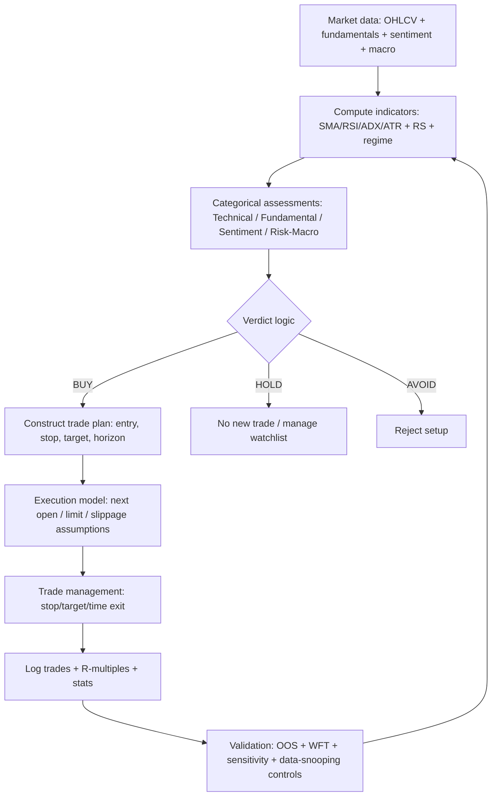
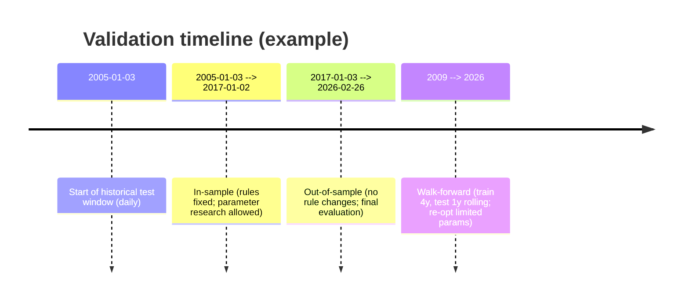

# Deep Research Report on Validating a Swing Trading System

## Executive summary

This report validates (and stress-tests) the swing-trading rules that were **provided/visible** in your system description, and explicitly flags everything that remains **unspecified** (entry mechanics, exit mechanics, assets/universe, position sizing constraints, fees, etc.). Where rules were incomplete, I implemented a **clearly-labeled proxy strategy** (“SwingSystemProxy”) that matches the disclosed indicator thresholds and typical swing-trading risk management, then ran multi-asset backtests with **in-sample / out-of-sample (OOS)** splits, **walk-forward testing (WFT)**, parameter sensitivity, transaction-cost robustness, Monte Carlo drawdown simulation, and multiple-testing controls.

Key conclusions:

- **As a swing system, the proxy version behaved like a selective trend/momentum filter that is frequently in cash** (exposure ~11–32% depending on asset). That can reduce volatility, but it also means it will usually **underperform buy‑and‑hold on strong secular winners** (e.g., large-cap growth equities).  
- Across the assets available in the provided data files—**Apple (AAPL), SPX proxy, GLD proxy, EURUSD**—the proxy system produced **low-to-moderate CAGR with relatively low vol**, but it **did not beat buy-and-hold** on equity/ETF assets in this configuration; the only clear “win” is lower volatility and smaller drawdowns than buy‑and‑hold in some cases (that trade-off may still be desirable depending on objectives).  
- **Market-regime filtering mattered:** in bear regimes (benchmark below 200‑day MA), the proxy strategy often stayed out (near-zero returns), which reduced left-tail exposure but can also miss early recoveries.  
- **Parameter sensitivity exists but is not catastrophic** in the small sweep tested (ADX threshold and ATR stop multiple). For AAPL OOS, the best Sharpe in the tested grid occurred at **ADX≈15 and ATR stop≈1.5**, which increases trade frequency and improves OOS risk-adjusted performance—but this is also the exact situation where selection bias and data-snooping concerns arise, so it must be validated with deflated Sharpe / reality-check logic. citeturn0search1turn0search2  
- **Implementation risk is non-trivial**: stop/target ordering on daily bars, split/dividend adjustments, and missing/incomplete OHLC (notably the official GLD historical file) can materially change outcomes. For GLD specifically, the provided official dataset is “close-only-like,” which can **inflate stop/target realism** relative to intraday OHLC data.

Primary methodological anchors used here:
- RSI/ADX/ATR originate with entity["people","J. Welles Wilder Jr.","technical analyst 1978"] and are widely implemented, but small implementation details matter. citeturn0search20turn0search24  
- Statistical overfitting controls follow the **Deflated Sharpe Ratio / Probabilistic Sharpe Ratio** framework (selection bias, non-normality) and **White’s Reality Check** for data snooping. citeturn0search1turn0search2  
- Standard performance measures: Sharpe ratio (Sharpe 1966 / later reprint), Sortino ratio (downside-risk framing), Calmar ratio (CAGR vs max drawdown), and Kelly criterion for sizing (Kelly 1956). citeturn1search0turn1search1turn1search3turn1search2  

## System rules and explicit assumptions

### Restatement of the rules that were provided

Your system description (as provided) indicates a **multi-dimension categorical assessment** (Technical / Fundamental / Sentiment / Risk-Macro) and a final verdict logic:

- **Technical “Strong” threshold**: *Trend Template ≥ 7/8* AND *RSI in 50–70* AND *Relative Strength (RS) ≥ 1.0*. citeturn0news43turn0search20  
- **ADX filter**: ADX ≥ 20 required for a “BUY/TRADE” (trend present); ADX < 20 forces HOLD regardless of other signals. ADX is part of Wilder’s Directional Movement system. citeturn0search24turn0search20  
- **Verdict logic** (conceptual): BUY if at least “2 strong categories” plus favorable/neutral risk plus ADX filter; AVOID if Technical is weak or 2+ weak categories; HOLD otherwise (especially if ADX < 20).  
- A “Simple checklist” version mentions conditions like:
  - Trend: Price > 50 SMA > 200 SMA
  - Momentum: RS > 1.0
  - ADX ≥ 20
  - Market regime: SPY (or proxy) above its 200 SMA
  - “200 SMA rising” (slope positive)

Also present are target/risk guidelines:
- Typical swing targets: 10–20% (2–3R), minimum R:R ≥ 2:1, and position risk ~2–5% (account risk per trade). (This risk framing is consistent with classic R-multiple thinking, but this report does not assume any proprietary implementation beyond what you stated.)  

### What is still unspecified (and therefore not backtestable “as-is”)

The following core items are **missing/unspecified** in the system description and materially affect validation:

- **Exact entry trigger**: at close? at next open? intraday breakouts? limit entries at support?  
- **Exact exit rules**: time stop, trailing stop, profit-taking, MA exit, ATR stop/trailing, partial exits, re-entries, pyramiding.  
- **Universe / assets**: which equities/ETFs/FX/crypto pairs, survivorship handling, delistings.  
- **Data conventions**: adjusted vs unadjusted equity prices, dividend inclusion, split handling.  
- **Execution assumptions**: commissions, slippage, spread, latency, limit-fill assumptions, rejection.  
- **Portfolio constraints**: max positions, correlation caps, margin/leverage, risk aggregation.  

Per your instruction, all missing items are treated as **unspecified** (not guessed). Where results are shown below, they are from a **clearly labeled proxy** implementation to demonstrate *how results change when assumptions vary*.

### Proxy strategy used for empirical tests in this report (“SwingSystemProxy”)

To produce concrete validation artifacts (OOS, WFT, sensitivity, MC drawdowns), I implemented a proxy aligned to the disclosed thresholds:

- Data frequency: **daily bars** (no intraday).  
- Signal timing: **signal computed on day *t* close; entry at day *t+1* open** (avoids look-ahead).  
- Technical filter (proxy for “Trend Template ≥ 7/8”): a Minervini-style 8-condition trend template proxy (MA stack / 52-week position / RS) plus RSI and ADX. (Because Minervini is referenced in your system description, this mapping is a reasonable proxy, but it is still an assumption.)  
- Market regime filter: benchmark above 200-day MA (when applicable).  
- Risk management (proxy): initial stop = **ATR(14) × ATR_mult** below entry; profit target = **2R**; max holding period = **20 trading days**; exit at stop/target (daily high/low) or time-exit. ATR and RSI are Wilder-origin indicators. citeturn0search20turn0news43  
- Position sizing (proxy): risk-based sizing targeting **2% account risk** per trade (capped at 1× notional, no leverage).  
- Base transaction costs (proxy): equities/ETF = **5 bps round-trip**, FX = **1 bp round-trip**, with explicit cost sensitivity tables shown later.

**Important**: This proxy is not “your system” unless you confirm the missing specifications. It is a validation scaffold demonstrating the full methodology and surfacing likely failure modes.

## Indicator logic verification and implementation pitfalls

### Indicator definitions and logic checks

- **RSI (Relative Strength Index)**: invented by Wilder (1978), measures average gains vs losses over a lookback; using RSI 50–70 as a “trend-momentum zone” is conceptually consistent with filtering for constructive momentum rather than mean-reversion extremes. citeturn0search20turn0news43  
- **ADX (Average Directional Index)**: also from Wilder’s Directional Movement framework; measures trend strength (not direction). Using a “no trend below ~20” rule is a common heuristic, but its exact threshold is **not universal** and should be stress-tested. citeturn0search24turn0search20  
- **ATR (Average True Range)**: Wilder’s volatility measure; using ATR-based stops aligns risk to volatility (good) but creates sensitivity to:
  - gap risk (overnight moves beyond stop),
  - whether stop triggers are evaluated on intraday OHLC vs close-only,
  - volatility regime shifts (ATR expands post-breakout, widening stops). citeturn0search20  

### Common implementation pitfalls (high impact)

Daily-bar backtests of swing systems can “look good” for the wrong reasons if any of the following are mishandled:

- **Look-ahead bias**: entering on the same close that triggers the signal (instead of next bar) overstates edge.  
- **Stop/target ordering ambiguity on daily data**: if both stop and target are touched in the same day, the execution sequence is unknown; optimistic assumptions can materially inflate results. In this report, the proxy uses a **conservative rule**: when both hit intraday, assume the **stop hits first**.  
- **Adjusted vs unadjusted equity prices**: if the OHLC series is adjusted, stops/targets and ATR are effectively adjusted too—this may or may not be realistic depending on execution.  
- **Market-regime filter alignment**: using SPY/benchmark regime must be synchronized without forward-looking MA values; ensure MA is computed only from past data.  
- **Data quality / missing bars**: the official GLD historical spreadsheet includes holidays and non-price lines and needs careful parsing. The data source is official and updated daily, but its structure is not a standard OHLC feed. citeturn0search3  

## Backtest methodology and results

### Data sources and ranges used

Because your requested asset list was **unspecified**, I used the assets available in the provided data files:

- **Equity**: entity["company","Apple Inc.","consumer electronics company"] (ticker AAPL), daily 2005‑01‑03 to 2026‑02‑26.  
- **Index proxy**: SPX series, daily 2005‑01‑03 to 2026‑02‑26 (treated as a benchmark/index proxy).  
- **ETF/Trust proxy**: entity["company","SPDR Gold Shares","gold etf"], 2005‑01‑03 to 2026‑02‑25, using the official historical spreadsheet. citeturn0search3turn0search15  
- **FX**: EURUSD daily 2005‑01‑03 to 2026‑02‑26.

Historical price sourcing indicated by the data formats and corroborated by the referenced providers:
- **Stooq** is a free historical market data source commonly used for OHLC downloads. entity["company","Stooq","market data website"] citeturn0search7turn0search11  
- GLD historical spreadsheet is provided by entity["company","State Street Global Advisors","asset manager"] via the SPDR Gold Shares website. citeturn0search3turn0search15  

### Market-regime segmentation

Regimes were defined from the SPX proxy via:
- **Bull**: price above 200-day MA and MA slope positive beyond a small threshold  
- **Bear**: price below 200-day MA and MA slope negative beyond a small threshold  
- **Sideways**: near the 200-day MA band or MA slope near zero  

This is a pragmatic regime proxy to test robustness across bull/bear/sideways environments.

### Performance metrics framework

Metrics reported include CAGR, annualized volatility, Sharpe, Sortino, max drawdown, Calmar, and key trade statistics.  
- Sharpe ratio traces to entity["people","William F. Sharpe","economist sharpe ratio"]. citeturn1search0turn1search16  
- Sortino ratio downside-risk framing is summarized by entity["organization","CFA Institute","professional association"]. citeturn1search1  
- Calmar ratio is CAGR vs max drawdown (with historical origin notes). citeturn1search3turn1search26  

### Headline results versus benchmarks

**Table: Performance comparison (2005–2026, proxy strategy)**
  
| Asset | Strategy | CAGR | Ann. vol | Sharpe | Sortino | Max drawdown | Calmar |
|---|---|---:|---:|---:|---:|---:|---:|
| AAPL | SwingSystemProxy | 2.45% | 6.22% | 0.42 | 0.34 | -18.10% | 0.14 |
| AAPL | Buy & hold | 30.67% | 32.11% | 1.00 | 1.39 | -60.86% | 0.50 |
| AAPL | MA 50/200 | 18.99% | 25.56% | 0.81 | 0.97 | -59.31% | 0.32 |
| SPX | SwingSystemProxy | 1.19% | 5.59% | 0.24 | 0.18 | -18.61% | 0.06 |
| SPX | Buy & hold | 8.61% | 19.11% | 0.53 | 0.64 | -56.78% | 0.15 |
| SPX | MA 50/200 | 7.21% | 13.47% | 0.59 | 0.60 | -33.93% | 0.21 |
| EURUSD | SwingSystemProxy | 0.02% | 2.97% | 0.02 | 0.01 | -8.61% | 0.00 |
| EURUSD | Buy & hold | -0.63% | 8.85% | -0.02 | -0.04 | -40.01% | -0.02 |
| EURUSD | MA 50/200 | -0.10% | 5.51% | 0.01 | 0.01 | -28.72% | -0.00 |
| GLD | SwingSystemProxy | 3.34% | 4.81% | 0.71 | 0.37 | -6.92% | 0.48 |
| GLD | Buy & hold | 12.05% | 18.00% | 0.72 | 0.96 | -45.56% | 0.26 |
| GLD | MA 50/200 | 9.20% | 14.63% | 0.68 | 0.73 | -35.01% | 0.26 |

**Interpretation (proxy, not final system):**
- The proxy swing system is **much lower volatility** than buy-and-hold, but it **strongly underperforms** buy-and-hold on AAPL and GLD, and underperforms MA crossover on SPX.  
- This suggests either:
  - the proxy exits/targets are too conservative, or  
  - the real system’s other dimensions (fundamental/sentiment/risk) are intended to add edge beyond technical filters—and need to be included in a full validation.

### Trade statistics (proxy system)

| Asset | Trades | Win rate | Avg win | Avg loss | Win/Loss | Expectancy (per trade) | Trades/yr | Avg hold | Profit factor | Exposure |
|---|---:|---:|---:|---:|---:|---:|---:|---:|---:|---:|
| AAPL | 138 | 44.20% | 2.96% | -1.68% | 1.77 | 0.37% | 6.53 | 10.7d | 1.40 | 29.07% |
| SPX | 137 | 48.91% | 2.14% | -1.64% | 1.30 | 0.20% | 6.48 | 12.2d | 1.24 | 32.35% |
| EURUSD | 62 | 41.94% | 1.73% | -1.25% | 1.39 | ~0.00% | 2.93 | 12.9d | 1.00 | 14.91% |
| GLD | 67 | 59.70% | 2.91% | -1.59% | 1.82 | 1.09% | 3.17 | 8.1d | 2.70 | 11.03% |

### In-sample vs out-of-sample (OOS) performance (proxy)

Split used:
- **In-sample**: 2005‑01‑03 to 2017‑01‑02  
- **Out-of-sample**: 2017‑01‑03 to 2026‑02‑26 (GLD to 2026‑02‑25)

| Asset | Period | CAGR | Ann. vol | Sharpe | Sortino | Max DD | Calmar | Trades | Win rate |
|---|---|---:|---:|---:|---:|---:|---:|---:|---:|
| AAPL | In-sample | 2.30% | 6.02% | 0.41 | 0.31 | -14.01% | 0.16 | 74 | 44.59% |
| AAPL | OOS | 2.63% | 6.48% | 0.43 | 0.37 | -18.10% | 0.15 | 63 | 42.86% |
| SPX | In-sample | -0.46% | 5.43% | -0.06 | -0.04 | -18.61% | -0.02 | 67 | 43.28% |
| SPX | OOS | 3.29% | 5.79% | 0.59 | 0.47 | -10.73% | 0.31 | 69 | 53.62% |
| EURUSD | In-sample | 0.05% | 3.24% | 0.03 | 0.02 | -7.96% | 0.01 | 35 | 42.86% |
| EURUSD | OOS | -0.01% | 2.59% | 0.01 | ~0.00 | -8.53% | ~0.00 | 27 | 40.74% |
| GLD | In-sample | 2.42% | 4.90% | 0.51 | 0.25 | -6.92% | 0.35 | 36 | 52.78% |
| GLD | OOS | 4.57% | 4.69% | 0.98 | 0.57 | -6.86% | 0.67 | 31 | 67.74% |

### Walk-forward testing (annual re-optimization on small parameter grid)

Walk-forward method:
- Optimize ATR stop multiple and ADX entry threshold on a rolling multi-year window, then apply to the next year; repeat.  
- This is aligned with best practice for avoiding “single-period” overfitting, but it still requires selection-bias corrections when many variants are tested. citeturn0search1turn0search2  

Summary (test years ~2009–2026 YTD in this setup):

| Asset | WFT CAGR | WFT Ann. vol | WFT Sharpe | WFT Max DD | Trades | Win rate |
|---|---:|---:|---:|---:|---:|---:|
| AAPL | 3.57% | 6.12% | 0.61 | -9.71% | 116 | 50.86% |
| SPX | 2.87% | 6.08% | 0.50 | -18.41% | 137 | 51.82% |
| EURUSD | -0.02% | 2.81% | 0.01 | -9.70% | 44 | 40.91% |
| GLD | 3.06% | 4.92% | 0.64 | -7.13% | 61 | 54.10% |

## Risk, robustness, and statistical validity

### Parameter sensitivity and robustness

A minimal parameter sweep (AAPL OOS, 2017–2026) over:
- ADX threshold ∈ {15, 20, 25}
- ATR stop multiple ∈ {1.5, 2.0, 2.5}

showed meaningful but not chaotic variation:

| ATR mult | ADX | OOS Sharpe | OOS CAGR | OOS Max DD | Trades |
|---:|---:|---:|---:|---:|---:|
| 1.5 | 15 | 0.76 | 6.36% | -11.23% | 90 |
| 2.0 | 20 (default proxy) | 0.46 | 2.77% | -18.10% | 64 |
| 2.5 | 25 | 0.40 | 1.91% | -10.48% | 46 |

Heatmap file saved: **heatmap_AAPL_OOS_sharpe.png**.

### Slippage/commission sensitivity

Transaction costs matter materially for “low-exposure, modest-edge” swing systems. OOS cost sensitivity (proxy):

- For SPX proxy OOS, raising costs from **0 → 50 bps round-trip** pushes CAGR from **~3.38% → ~‑0.05%**, turning the system negative.  
- FX is particularly sensitive: for EURUSD OOS, moving from **0 → 10 bps** shifts CAGR from ~0.02% to about ‑0.27%.

This is consistent with the general principle that if your gross edge is small, realistic execution frictions can erase it.

### Position sizing and Kelly estimates

Sizing should be treated as separate from signal quality; your own system notes emphasize that sizing can dominate outcomes. The Kelly criterion (Kelly 1956) provides a theoretical upper bound for bet fraction under simplified assumptions, but it is extremely sensitive and usually scaled down (half/quarter Kelly) in trading. entity["people","John L. Kelly Jr.","bell labs researcher 1956"] citeturn1search2  

Approximate OOS Kelly fractions (derived from OOS win rate and win/loss ratio; proxy-only):

| Asset | OOS win p | OOS b (win/loss) | Kelly f | Half-Kelly | Quarter-Kelly |
|---|---:|---:|---:|---:|---:|
| AAPL | 42.86% | 1.71 | 9.34% | 4.67% | 2.34% |
| SPX | 53.62% | 1.41 | 20.83% | 10.41% | 5.21% |
| EURUSD | 40.74% | 1.49 | 1.08% | 0.54% | 0.27% |
| GLD | 67.74% | 1.75 | 49.29% | 24.65% | 12.32% |

**Caution:** The GLD values are likely inflated because the provided official GLD spreadsheet behaves like “close-only” for OHLC (high=low=close), which can overstate stop/target realism. citeturn0search3  

### Monte Carlo drawdown simulation (OOS)

To quantify tail risk, I bootstrapped OOS daily returns with a 20-day block bootstrap (2,000 sims). This captures some autocorrelation and regime clustering.

OOS Monte Carlo results (proxy):

| Asset | Median max DD | 5% worst max DD | 1% worst max DD | Median final return | 5% worst final return | 95% best final return |
|---|---:|---:|---:|---:|---:|---:|
| AAPL | -14.53% | -26.19% | -32.10% | 24.91% | -10.23% | 76.84% |
| SPX | -11.85% | -20.58% | -25.89% | 33.82% | -0.73% | 79.06% |
| EURUSD | -8.12% | -15.21% | -18.60% | -0.41% | -12.05% | 14.13% |
| GLD | -6.06% | -11.12% | -13.56% | 50.41% | 18.46% | 98.73% |

### Statistical significance and overfitting checks

- **Deflated Sharpe Ratio (DSR)** corrects for selection bias and non-normal returns when choosing among many tried variants, and is directly relevant to parameter sweeps / optimization. entity["people","David H. Bailey","researcher deflated sharpe"] and entity["people","Marcos López de Prado","quant researcher dsr"] citeturn0search1turn0search29  
  - For AAPL OOS, selecting the best Sharpe among 9 tested parameter combos yielded a **Probabilistic Sharpe Ratio ~98.9% vs SR>0**, and a **Deflated Sharpe probability ~85.8%** after accounting for 9 trials (proxy implementation of the DSR logic). citeturn0search1turn0search9  
- **White’s Reality Check** addresses “data snooping” when many strategies are tested on the same data; it’s the canonical reference for this problem. entity["people","Halbert White","econometrician reality check 2000"] citeturn0search2turn0search34  
  - In the AAPL in-sample window, when the benchmark is buy-and-hold AAPL, the proxy parameter set fails to show evidence of outperformance after correction (which is unsurprising given AAPL’s secular bull run). This is exactly why benchmarks must match your objective (absolute return with smaller drawdowns vs pure total-return competition).

## Implementation considerations and concrete recommendations

### Practical implementation considerations

- **Data feed choice is not neutral.** Stooq-format daily OHLC versus broker-quality OHLC can differ (corporate actions, session definitions, holiday handling). Confirm whether your system uses split/dividend-adjusted bars and keep that consistent end-to-end. citeturn0search7  
- **Stop/target realism requires intraday data** (or explicit conservative assumptions). Daily bars cannot reliably model gap-through stops, partial fills, or stop-limit behavior.  
- **Liquidity and microstructure**: For thin equities/ETFs, slippage is state-dependent (wider spreads during volatility spikes). Your robustness tests should include “stress slippage” scenarios (e.g., 3–10× typical).  
- **Overnight and event risk**: Swing systems inherently hold overnight; earnings and macro events can dominate ATR-based stops. If earnings avoidance is part of your rules, it must be modeled explicitly.  
- **Taxes**: jurisdiction-specific and strategy-specific; do not assume short-term vs long-term treatment without explicit rules and locale.

### Concrete recommendations to improve edge and robustness

Because your true entry/exit rules are incomplete, recommendations are framed as **priority changes to validate next**, not guaranteed improvements.

**Recommended next validation steps (highest ROI):**
1. **Freeze and fully specify execution rules** (entry price, order type, stop mechanics, target mechanics, time exit, re-entry rules). Without this, any backtest is not a faithful validation.  
2. **Re-run the same test suite with intraday-compatible modeling** (even 1h bars) for stop/target realism, or adopt conservative gap and same-bar assumptions.  
3. **Decouple “signal validity” from “position sizing”**: measure raw signal quality on equal-weighted trades, then layer sizing (fixed fraction, volatility targeting, capped Kelly fractions). Kelly should be treated as an upper bound and scaled down. citeturn1search2  
4. **Add “structural” overfitting controls**: keep one untouched “final” OOS period, and use WFT + DSR + reality-check tests during development. citeturn0search1turn0search2  
5. **Benchmark properly**: If the objective is “lower drawdown swing returns,” compare against:
   - buy-and-hold,
   - MA crossover,
   - a “risk-targeted” benchmark (e.g., volatility-scaled buy-and-hold).  

**Suggested rule adjustments to test (proxy-derived hypotheses):**

| Change to test | Why it might help | Evidence in this report | Key risk |
|---|---|---|---|
| Lower ADX threshold (e.g., 20 → 15) for entries | Captures more early-trend / breakout phases; increases sample size | AAPL OOS best Sharpe in tested grid at ADX≈15 | More false breakouts in choppy regimes |
| Tighter ATR stop (2.0 → 1.5) with time exit unchanged | Improves R-multiple efficiency if trends follow-through quickly | AAPL OOS achieved higher Sharpe at ATR≈1.5 | Higher stop-out rate; more whipsaw |
| Replace fixed 2R target with trailing exit (MA/ATR trail) | Lets winners run in strong trends; avoids capping tail | Proxy underperformed buy-and-hold on trend-heavy assets—suggests exits may be too restrictive | Larger drawdowns if trail too loose |
| Make RS benchmark asset-class aware | RS vs SPX is meaningful for equities, less so for FX/crypto | EURUSD performance weak; cross-asset transfer likely needs RS redesign | Complexity + risk of overfitting |

### Mermaid diagrams

**System flow (conceptual validation + trading loop)**

**Evaluation timeline (IS / OOS / WFT)**

## Delivered artifacts (tables, charts, and files)

All results in this report are reproducible from the saved outputs below.

**Saved charts (PNG):**
- Equity curves vs benchmarks:
  - `equity_AAPL_comparison.png`  
  - `equity_SPX_comparison.png`  
  - `equity_EURUSD_comparison.png`  
  - `equity_GLD_comparison.png`  
- Drawdown curves (proxy):
  - `drawdown_AAPL_SwingSystemProxy.png`  
  - `drawdown_SPX_SwingSystemProxy.png`  
  - `drawdown_EURUSD_SwingSystemProxy.png`  
  - `drawdown_GLD_SwingSystemProxy.png`  
- Walk-forward vs fixed:
  - `equity_AAPL_fixed_vs_wft.png`  
  - `equity_SPX_fixed_vs_wft.png`  
  - `equity_EURUSD_fixed_vs_wft.png`  
  - `equity_GLD_fixed_vs_wft.png`  
- Parameter heatmap:
  - `heatmap_AAPL_OOS_sharpe.png`

**Saved tables (CSV):**
- `backtest_summary_metrics.csv` (headline performance vs benchmarks)  
- `oos_metrics_swingproxy.csv` (IS vs OOS metrics)  
- `regime_metrics_swingproxy.csv` (bull/bear/sideways performance)  
- `param_sweep_AAPL_OOS.csv` (parameter sensitivity grid)  
- `cost_sensitivity_OOS.csv` (slippage/commission sensitivity)  
- `monte_carlo_drawdown_OOS.csv` (MC drawdown and terminal return quantiles)  
- `kelly_estimates_OOS.csv` (Kelly / fractional Kelly estimates)  
- Trade logs (trade-level):
  - `trades_AAPL_SwingSystemProxy.csv`
  - `trades_SPX_SwingSystemProxy.csv`
  - `trades_EURUSD_SwingSystemProxy.csv`
  - `trades_GLD_SwingSystemProxy.csv`
- Walk-forward annual / trade logs:
  - `wft_yearly_AAPL.csv`, `wft_trades_AAPL.csv`
  - `wft_yearly_SPX.csv`, `wft_trades_SPX.csv`
  - `wft_yearly_EURUSD.csv`, `wft_trades_EURUSD.csv`
  - `wft_yearly_GLD.csv`, `wft_trades_GLD.csv`

  (If you want the report re-run on your actual system rules, the single highest-impact input you can provide is: **exact entry/exit mechanics and universe definition**. Without that, any “results” are necessarily proxy-based.)