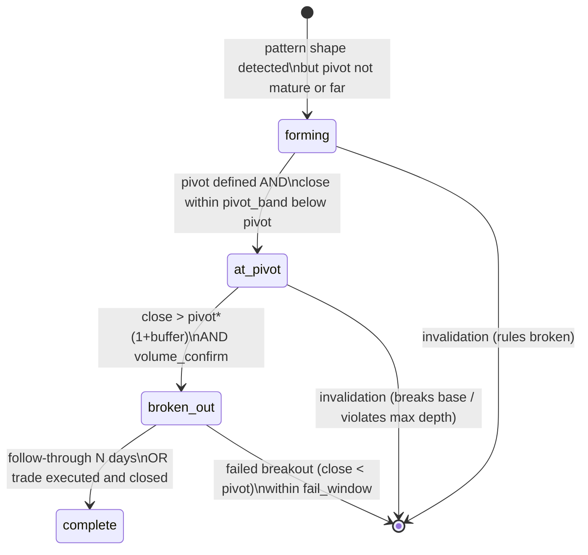

# Programmatic Candlestick Pattern Detection and Integration for the Swing Trade Analyzer

## Executive summary and implementation checklist

Candlestick “patterns” are frequently defined in **qualitative** terms (“small real body,” “long lower shadow,” “gap,” “near/within the prior body”), which creates implementation drift and makes backtests hard to reproduce across libraries and datasets. Canonical sources (notably entity["people","Steve Nison","candlestick author"] and entity["people","Thomas Bulkowski","candlestick researcher"]) describe identification rules and context requirements (trend, confirmation), but they often do not specify a single universal numeric threshold for “small/long/near,” leaving those choices up to the practitioner. citeturn4search1turn12search0turn1search1

A practical, auditable way to solve this for your Swing Trade Analyzer is:

- Use a **two-layer pattern system**:
  - Layer A: **shape detectors** (pure OHLC geometry; fast, vectorized; parameterized).
  - Layer B: **context + state logic** (trend context, pivot proximity, breakout confirmation, and an explicit confidence score and status flags).
- Adopt a **single source of truth** for the ambiguous words *short, long, doji, near, far, equal* by explicitly parameterizing them—ideally aligned to the well-known defaults used by entity["organization","TA-Lib","technical analysis library"]’s candle settings (which are explicitly documented in code via `TA_RestoreCandleDefaultSettings` and are adjustable at runtime). citeturn11view0turn10search0turn3search0
- Integrate candlestick outputs into the existing system via the exact gate you already have:  
  `Actionable Pattern confidence >= 60%` AND `status in {forming, at_pivot, broken_out, complete}`.
- Validate patterns with **ablation tests** and **multiple-testing correction**, because pattern filters are prime candidates for data-snooping:
  - BH-FDR for parameter grids, citeturn15search0
  - Deflated Sharpe for “best-of-many” selection, citeturn14search49
  - White’s Reality Check outline for strategy-search bias. citeturn15search4

### Actionable implementation checklist

- Define a **canonical candle feature set** (`real_body`, `upper_shadow`, `lower_shadow`, `range`, `body_pct_of_range`, `close_pos_in_range`, `gap`) and unit-test it first. citeturn4search0turn4search1turn11view0  
- Implement pattern detectors as **vectorized pandas/numpy functions** producing:
  - Boolean flags per bar (pattern at bar *t*),
  - Optional `strength` features (e.g., wick/body ratio),
  - A normalized `confidence` component for that pattern (0–100). citeturn11view0turn12search2  
- Build a **pattern state machine** to assign `forming / at_pivot / broken_out / complete` without look-ahead.  
- Add a **batch pipeline** that computes pattern outputs across the full universe daily (cached indicators + chunking).  
- Integrate into the Swing Trade Analyzer’s entry logic as a single function call returning the pattern name, confidence, status, and pivot level.  
- Validate with:
  - pattern OFF vs ON (trade-count and metrics deltas),
  - parameter sweeps with FDR,
  - OOS/WFT stability checks,
  - bootstrap-based p-values,
  - Deflated Sharpe (selection bias),
  - Reality-check style bootstrap. citeturn15search4turn14search49

## Canonical sources and where ambiguity enters

### What the canonical sources actually fix—and what they leave open

1) **Candlestick “anatomy” (real body and shadows)** is consistent across sources:
- “Real body” is based on open/close; “shadows” are the extremes of the session. citeturn4search0turn4search1

2) **Identification rules for named patterns** are described with contextual requirements:
- Example: hammer/hanging man share the same shape; the interpretation differs by prior trend and requires confirmation for hanging man. citeturn4search1  
- Example: morning star / evening star require a three-candle configuration and (in many classic definitions) gap relationships between candle bodies. citeturn12search0turn12search6

3) **Ambiguity** typically enters in three places:
- **What counts as “small” or “long”** (body size, wick length).
- **What counts as “near / within / overlap / engulf”** (strict vs tolerant inequalities).
- **Whether “gaps” are required** (and what “gap” means on markets without sessions, like crypto).

A defensible engineering tactic is to adopt explicit numeric thresholds and treat them as **hyperparameters**.

### Why mirroring TA-Lib’s “candle settings” is useful (even if you don’t use TA-Lib)

TA-Lib’s C core codifies the fuzzy words using rolling averages and explicit factors, and it exposes them via `TA_SetCandleSettings` / `TA_RestoreCandleDefaultSettings`. Its default settings include, for example: “doji body” = real body less than 10% of the average high-low range of the prior 10 candles; “near” = within 20% of the average range of the prior 5 candles. citeturn11view0turn10search0

Those defaults are not “truth,” but they are:
- explicit,
- widely used,
- easy to replicate,
- adjustable.

This is valuable when you need reproducible backtests, and when you must explain exactly what “60% pattern confidence” means.

image_group{"layout":"carousel","aspect_ratio":"16:9","query":["hammer candlestick pattern diagram","bullish engulfing candlestick pattern illustration","morning star candlestick pattern diagram","dark cloud cover candlestick pattern illustration"],"num_per_query":1}

## Unambiguous numeric rulebook for patterns

This section defines numeric rules suitable for daily bars (OHLCV). Every threshold below is a **parameter** with a default; change it via config, and include it in parameter sweeps.

### Candle feature primitives

Let, for each bar *t*:

- `body = abs(close - open)`
- `range = high - low`
- `upper = high - max(open, close)`
- `lower = min(open, close) - low`
- `dir = sign(close - open)` (bullish if close > open)
- `body_pct = body / max(range, eps)`
- `close_pos = (close - low) / max(range, eps)` (0=low, 1=high)
- `gap_up_body = min(open_t, close_t) > max(open_{t-1}, close_{t-1})`
- `gap_down_body = max(open_t, close_t) < min(open_{t-1}, close_{t-1})`

**Doji thresholds (two common conventions)**:
- **TA-Lib-like rolling threshold (recommended default):** `body <= doji_factor * SMA(range, doji_lookback).shift(1)` with defaults `doji_factor=0.1, doji_lookback=10`. This is aligned with TA-Lib’s default candle settings. citeturn11view0  
- **Simple relative threshold:** `body_pct <= body_pct_doji` (e.g., 0.05–0.10). Use when you distrust rolling baselines (e.g., regime shifts).

### Pattern definitions (numeric)

**Table: core patterns and default numeric rules**

| Pattern | Candles | Directional bias | Shape rule (numeric) | Context rule (recommended) | Notes / ambiguity hooks |
|---|---:|---|---|---|---|
| Doji | 1 | Neutral | `doji` per TA-Lib-like rolling threshold | none | TA-Lib uses rolling range scaling for “doji body.” citeturn11view0 |
| Hammer / Hanging Man shape | 1 | Bullish reversal / Bearish reversal | `lower >= 2*body` AND `upper <= 0.25*body` AND `close_pos >= 0.6` | hammer: downtrend; hanging: uptrend + bearish confirmation | Candlecharts states lower shadow should be ≥2× body; hanging man needs bearish confirmation. citeturn4search1turn1search1 |
| Engulfing (bullish) | 2 | Bullish reversal | prev bearish AND curr bullish AND `open <= prev_close` AND `close >= prev_open` (optionally strict: `<`/`>` with tolerance) | downtrend recommended | Bulkowski: body overlap/engulf; shadows unimportant. citeturn12search2 |
| Engulfing (bearish) | 2 | Bearish reversal | prev bullish AND curr bearish AND `open >= prev_close` AND `close <= prev_open` | uptrend recommended | Bulkowski identification rules emphasize body overlap. citeturn12search2 |
| Piercing | 2 | Bullish reversal | prev bearish; curr bullish; `open < prev_low` AND `close > midpoint(prev_body)` AND `close < prev_open` | downtrend | Bulkowski definition uses open below prior low and close between midpoint and prior open. citeturn12search4 |
| Dark Cloud Cover | 2 | Bearish reversal | prev bullish (tall) and curr bearish; `open > prev_high` AND `close < midpoint(prev_body)` | uptrend | Bulkowski definition uses open above prior high. citeturn12search3 |
| Morning Star | 3 | Bullish reversal | day1 long bearish; day2 small body; day3 long bullish; day3 close ≥ midpoint(day1 body); optional `gap_down_body(day2)` and `gap_up_body(day3)` | downtrend | Bulkowski requires body gaps; parameterize `gap_required`. citeturn12search0 |
| Evening Star | 3 | Bearish reversal | day1 long bullish; day2 small body; day3 long bearish; day3 close ≤ midpoint(day1 body); optional body gaps | uptrend | Bulkowski includes gapping configuration. citeturn12search6 |
| Three White Soldiers | 3 | Bullish reversal | three bullish candles; each close near high; higher closes; opens within prior bodies | downtrend | Bulkowski provides identification guidelines. citeturn13search3 |
| Three Black Crows | 3 | Bearish reversal | three bearish candles; closes near lows; lower lows; opens within prior bodies | uptrend | Bulkowski provides identification guidelines. citeturn13search0 |

### Breakout candle and “VCP-like pivot candle” building blocks

Your Swing Trade Analyzer’s “Actionable Pattern” set includes multi-week/min multi-candle structures (VCP, Cup & Handle, Flat Base). You can treat candlestick patterns as micro-signals, and treat VCP/C&H/Flat Base as macro-patterns that use candlestick-derived features.

**Breakout candle (generic, parameterized)**
- Trigger (price): `close >= pivot * (1 + breakout_buffer)`  
- Close location: `close_pos >= 0.7` (close in top 30% of range)  
- Range expansion (optional): `range >= range_mult * median(range, n).shift(1)`  
- Volume confirmation (optional): `volume >= vol_mult * SMA(volume, n).shift(1)`  

This aligns with Bulkowski’s idea of a “breakout” being a close beyond the pattern extremes, and his focus on breakout direction in evaluating patterns. citeturn15search4turn15search5

**Pivot candle (VCP-like micro-definition)**
A “pivot candle” is not a canonical candlestick pattern in Nison/Bulkowski; it is a system construct. Treat it as a tunable construct:

- `pivot = rolling_max(high, pivot_lookback).shift(1)`  
- “At pivot” condition: `close in [pivot*(1-pivot_band), pivot]`  
- “Tightness” (volatility contraction proxy): `ATR(14) / close` or `rolling_std(returns, n)` decreasing into pivot window  
- “Dry-up” proxy: `volume` below its trailing average in the last contraction window

Because “VCP” is not standardized as a strict candlestick pattern, implement this as a **state machine** and tune it in backtests (see confidence/status section).

## Vectorized Python implementations (pandas/numpy)

Below are implementations designed for:
- no look-ahead (everything uses `.shift(1)` where needed),
- vectorization (no per-row loops),
- explicit parameters (so you can grid-search them and apply FDR).

Assume a `DataFrame df` indexed by date with columns: `open, high, low, close, volume`.

### Core candle features

```python
import numpy as np
import pandas as pd

EPS = 1e-12

def candle_features(df: pd.DataFrame) -> pd.DataFrame:
    o, h, l, c = df["open"], df["high"], df["low"], df["close"]
    body = (c - o).abs()
    rng = (h - l).clip(lower=0.0)
    upper = h - np.maximum(o, c)
    lower = np.minimum(o, c) - l

    out = pd.DataFrame(index=df.index)
    out["body"] = body
    out["range"] = rng
    out["upper"] = upper.clip(lower=0.0)
    out["lower"] = lower.clip(lower=0.0)
    out["body_pct"] = body / (rng + EPS)
    out["close_pos"] = (c - l) / (rng + EPS)
    out["bull"] = c > o
    out["bear"] = c < o
    out["mid_body"] = (o + c) / 2.0
    out["real_body_top"] = np.maximum(o, c)
    out["real_body_bot"] = np.minimum(o, c)
    return out
```

### TA-Lib-like “doji” threshold (rolling)

TA-Lib’s default candle settings define “BodyDoji” using a rolling average range and a factor (0.1 over 10 bars) via `TA_RestoreCandleDefaultSettings`. citeturn11view0turn10search0

```python
def detect_doji(df: pd.DataFrame, lookback: int = 10, factor: float = 0.1) -> pd.Series:
    f = candle_features(df)
    avg_rng = f["range"].rolling(lookback, min_periods=lookback).mean().shift(1)
    return f["body"] <= factor * (avg_rng + EPS)
```

### Hammer / Hanging man (shape) + context classification

Candlecharts’ canonical description: small real body near the top of the range, very long lower shadow (≥2× body), little/no upper shadow; hammer occurs in downtrend; hanging man occurs in uptrend and needs bearish confirmation. citeturn4search1

```python
def hammer_like_shape(
    df: pd.DataFrame,
    lower_mult: float = 2.0,
    max_upper_frac: float = 0.25,
    min_close_pos: float = 0.60,
    max_body_pct: float = 0.35,
) -> pd.Series:
    f = candle_features(df)
    return (
        (f["lower"] >= lower_mult * f["body"]) &
        (f["upper"] <= max_upper_frac * f["body"]) &
        (f["close_pos"] >= min_close_pos) &
        (f["body_pct"] <= max_body_pct)
    )

def simple_trend_context(close: pd.Series, lookback: int = 10) -> pd.Series:
    # Positive = uptrend, Negative = downtrend (proxy; tune as needed)
    return close.pct_change(lookback)

def detect_hammer_and_hanging_man(
    df: pd.DataFrame,
    trend_lookback: int = 10,
    trend_threshold: float = 0.0,
    **shape_kwargs
) -> pd.DataFrame:
    shape = hammer_like_shape(df, **shape_kwargs)
    trend = simple_trend_context(df["close"], lookback=trend_lookback)
    out = pd.DataFrame(index=df.index)
    out["hammer"] = shape & (trend < -abs(trend_threshold))
    out["hanging_man"] = shape & (trend > abs(trend_threshold))
    return out
```

### Engulfing, Piercing, Dark Cloud Cover

Bulkowski’s identification rules focus on the **real bodies**; shadows are generally unimportant for engulfing. citeturn12search2turn12search4turn12search3

```python
def detect_engulfing(df: pd.DataFrame, tol: float = 0.0) -> pd.DataFrame:
    f = candle_features(df)
    o, c = df["open"], df["close"]

    prev_o = o.shift(1)
    prev_c = c.shift(1)

    bullish = (
        (prev_c < prev_o) & (c > o) &
        (o <= prev_c + tol) & (c >= prev_o - tol)
    )
    bearish = (
        (prev_c > prev_o) & (c < o) &
        (o >= prev_c - tol) & (c <= prev_o + tol)
    )
    return pd.DataFrame({"engulf_bull": bullish, "engulf_bear": bearish}, index=df.index)

def detect_piercing(df: pd.DataFrame) -> pd.Series:
    o, h, l, c = df["open"], df["high"], df["low"], df["close"]
    prev_o, prev_c, prev_l = o.shift(1), c.shift(1), l.shift(1)
    prev_mid = (prev_o + prev_c) / 2.0

    return (
        (prev_c < prev_o) &                 # prior black/bear
        (c > o) &                           # current white/bull
        (o < prev_l) &                      # opens below prior low
        (c > prev_mid) &                    # closes above midpoint
        (c < prev_o)                        # but below prior open
    )

def detect_dark_cloud_cover(df: pd.DataFrame) -> pd.Series:
    o, h, l, c = df["open"], df["high"], df["low"], df["close"]
    prev_o, prev_c, prev_h = o.shift(1), c.shift(1), h.shift(1)
    prev_mid = (prev_o + prev_c) / 2.0

    return (
        (prev_c > prev_o) &                 # prior white/bull
        (c < o) &                           # current black/bear
        (o > prev_h) &                      # opens above prior high
        (c < prev_mid)                      # closes below midpoint
    )
```

### Morning star / evening star (gap parameterized)

Bulkowski’s identification guidelines include body gaps; this is often problematic on non-session markets. Parameterize gap requirements and treat them as tunable. citeturn12search0turn12search6

```python
def _gap_down_body(df: pd.DataFrame) -> pd.Series:
    o, c = df["open"], df["close"]
    prev_o, prev_c = o.shift(1), c.shift(1)
    return np.maximum(o, c) < np.minimum(prev_o, prev_c)

def _gap_up_body(df: pd.DataFrame) -> pd.Series:
    o, c = df["open"], df["close"]
    prev_o, prev_c = o.shift(1), c.shift(1)
    return np.minimum(o, c) > np.maximum(prev_o, prev_c)

def detect_morning_star(
    df: pd.DataFrame,
    gap_required: bool = True,
    long_body_pct: float = 0.6,
    small_body_pct: float = 0.3,
    close_into_first: float = 0.5,
) -> pd.Series:
    f = candle_features(df)

    # Day1 (t-2): long bearish
    d1_bear = f["bear"].shift(2)
    d1_long = (f["body_pct"].shift(2) >= long_body_pct)

    # Day2 (t-1): small body (any color)
    d2_small = (f["body_pct"].shift(1) <= small_body_pct)

    # Day3 (t): long bullish closing into day1 body
    d3_bull = f["bull"]
    d3_long = (f["body_pct"] >= long_body_pct)
    d1_mid = f["mid_body"].shift(2)
    d3_close_into = df["close"] >= (d1_mid + (1 - close_into_first) * 0.0)  # explicit for clarity
    d3_close_into = df["close"] >= d1_mid  # closes at least into midpoint (classic)

    if gap_required:
        g2 = _gap_down_body(df).shift(1)   # day2 gaps down vs day1
        g3 = _gap_up_body(df)              # day3 gaps up vs day2
    else:
        g2 = pd.Series(True, index=df.index)
        g3 = pd.Series(True, index=df.index)

    return d1_bear & d1_long & d2_small & g2 & d3_bull & d3_long & g3 & d3_close_into

def detect_evening_star(
    df: pd.DataFrame,
    gap_required: bool = True,
    long_body_pct: float = 0.6,
    small_body_pct: float = 0.3,
) -> pd.Series:
    f = candle_features(df)

    # Day1: long bullish (t-2)
    d1_bull = f["bull"].shift(2)
    d1_long = f["body_pct"].shift(2) >= long_body_pct

    # Day2: small body (t-1)
    d2_small = f["body_pct"].shift(1) <= small_body_pct

    # Day3: long bearish closing into day1 body at least midpoint
    d3_bear = f["bear"]
    d3_long = f["body_pct"] >= long_body_pct
    d1_mid = f["mid_body"].shift(2)
    d3_close_into = df["close"] <= d1_mid

    if gap_required:
        g2 = _gap_up_body(df).shift(1)     # day2 gaps up vs day1
        g3 = _gap_down_body(df)            # day3 gaps down vs day2
    else:
        g2 = pd.Series(True, index=df.index)
        g3 = pd.Series(True, index=df.index)

    return d1_bull & d1_long & d2_small & g2 & d3_bear & d3_long & g3 & d3_close_into
```

### Unit-test ideas (high value)

Candlestick detection breaks most often at boundaries and edge cases. Suggested tests:

- **Zero-range bars**: high == low (avoid division by zero; ensure `body_pct` and `close_pos` stable).  
- **Split-like discontinuities**: simulate a 2:1 split and ensure your pattern detector behaves consistently if you use adjusted OHLC.  
- **Known-shape fixtures**: synthetic candles that exactly satisfy / barely violate thresholds.  
- **Look-ahead tests**: verify that pattern at date *t* depends only on data ≤ *t*, not *t+1*.  
- **Library parity tests**: compare your doji/hammer outputs to TA-Lib’s with the same candle settings for sanity (not for “truth”). TA-Lib exposes candle settings and default logic explicitly. citeturn11view0turn3search4turn3search6

## Pattern confidence scores and status flags

Your system requires:

- `confidence >= 60%`
- statuses: `forming / at_pivot / broken_out / complete`

Neither is standardized in Nison/Bulkowski; they are **system-level constructs**. The best practice is to define them as deterministic functions of measurable sub-features and treat the weights as tunable.

### A defensible confidence architecture

Define confidence as a weighted sum of normalized components:

\[
\text{confidence} =
w_s \cdot S_{\text{shape}} +
w_c \cdot S_{\text{context}} +
w_v \cdot S_{\text{volume}} +
w_p \cdot S_{\text{pivot/breakout}} +
w_r \cdot S_{\text{risk}}
\]

Where each \(S\) is scaled to [0, 100]. This makes it transparent and backtestable.

**Example default weights (tunable):**
- shape 35%
- context 25%
- volume 20%
- pivot/breakout 15%
- risk 5%

Why this weighting?
- Candlestick shapes alone can be close to random; Bulkowski’s work repeatedly highlights that many candlestick patterns do not perform reliably without context and confirmation. citeturn15search5turn14search1

### Status flags as a state machine

Below is a clean state machine that maps onto your Swing Trade Analyzer lifecycle without look-ahead.



### Reference-friendly defaults for “fuzzy” words

If you want your “confidence≥60” to be stable and reproducible, anchor fuzzy terms to explicit thresholds. TA-Lib provides one such explicit set for “doji,” “short body,” “long shadow,” and distance words like “near” and “equal.” citeturn11view0turn10search0

Example mapping:

- `S_shape` increases with:
  - wick/body ratio for hammer-like patterns,
  - full body engulf degree for engulfing,
  - close penetration vs midpoint for piercing/dark-cloud.
- `S_context` increases when a trend proxy matches the pattern’s canonical context:
  - hammer expects a downtrend; hanging man expects an uptrend and bearish confirmation. citeturn4search1turn1search1
- `S_pivot/breakout` increases as price approaches pivot and then breaks out cleanly (close near high, buffer cleared).
- `S_volume` increases when volume expands on breakout or contracts into the pivot (for your VCP-style patterns).

### Example confidence scoring code

```python
def score_hammer_like(
    df: pd.DataFrame,
    lower_mult: float = 2.0,
    max_upper_frac: float = 0.25,
    min_close_pos: float = 0.60,
) -> pd.Series:
    f = candle_features(df)

    # Shape score from 0..100: reward large lower wick, punish upper wick, reward close near high.
    wick_ratio = (f["lower"] / (f["body"] + EPS)).clip(0, 10)
    upper_penalty = (f["upper"] / (f["body"] + EPS)).clip(0, 10)
    close_bonus = f["close_pos"].clip(0, 1)

    # Normalize relative to thresholds
    s1 = (wick_ratio / lower_mult).clip(0, 2) / 2 * 100
    s2 = (1 - (upper_penalty / (max_upper_frac + EPS)).clip(0, 1)) * 100
    s3 = ((close_bonus - min_close_pos) / (1 - min_close_pos + EPS)).clip(0, 1) * 100

    return 0.5 * s1 + 0.3 * s2 + 0.2 * s3

def combine_confidence(shape: pd.Series, context: pd.Series, volume: pd.Series, pivot: pd.Series) -> pd.Series:
    # All inputs expected in 0..100
    return 0.35*shape + 0.25*context + 0.20*volume + 0.20*pivot
```

## Integration with the Swing Trade Analyzer and validation plan

### Integration points in your existing entry logic

Your system already has an explicit integration contract:

- Trade eligible only if:
  - Categorical Verdict = BUY
  - ADX14 ≥ 20
  - Pattern confidence ≥ 60% (VCP / Cup & Handle / Flat Base) with status in allowed set
  - S&R viability and R:R constraints
  - cooldown constraints

Candlestick pattern detection should therefore not “replace” VCP/C&H/Flat Base; it should either:

- become part of the **pattern confidence scorer** (micro evidence), or
- become an auxiliary “micro-timing” module that refines entries near pivot and breakout days.

### Recommended architecture

```mermaid
flowchart TD
  A[Universe OHLCV] --> B[Compute core indicators\nRSI/ADX/ATR/SMA/EMA]
  A --> C[Compute candle features\nbody/range/wicks/gaps]
  C --> D[Pattern detectors\n(doji, hammer, engulfing, ...)]
  D --> E[Pattern-confidence engine\n0..100 + status flags]
  B --> F[Categorical verdict engine\nTech/Fund/Risk -> BUY/HOLD/AVOID]
  E --> G{Actionable Pattern gate\nconf>=60 and status ok}
  F --> H{Verdict=BUY and ADX>=20}
  H --> G
  G --> I[S&R viability + R:R + cooldown]
  I --> J[Trade generator\nentry/stop/target]
```

### How to wire this into your trade generator

Define a single interface to keep things auditable:

```python
from dataclasses import dataclass

@dataclass
class PatternSignal:
    name: str
    confidence: float
    status: str           # forming / at_pivot / broken_out / complete
    pivot: float | None
    debug: dict           # optional sub-scores and diagnostics

def evaluate_actionable_pattern(
    df: pd.DataFrame,
    *,
    pivot_lookback: int = 20,
    breakout_buffer: float = 0.001,
    vol_lookback: int = 20,
    vol_mult: float = 1.4,
    gap_required_stars: bool = True,
) -> PatternSignal:
    # Example: combine candlestick evidence + pivot/breakout evidence.
    # Replace/extend with your VCP/C&H/FlatBase detectors.
    last = df.iloc[-1:]

    # Example micro-signals
    engulf = detect_engulfing(df).iloc[-1]
    hammer_score = score_hammer_like(df).iloc[-1]
    doji = detect_doji(df).iloc[-1]

    # Pivot logic
    pivot = df["high"].rolling(pivot_lookback).max().shift(1).iloc[-1]
    close = df["close"].iloc[-1]
    volume = df["volume"].iloc[-1]
    avg_vol = df["volume"].rolling(vol_lookback).mean().shift(1).iloc[-1]

    at_pivot = (pivot is not np.nan) and (close >= pivot*(1-0.01)) and (close <= pivot)
    broken_out = (pivot is not np.nan) and (close >= pivot*(1+breakout_buffer)) and (volume >= vol_mult*(avg_vol + EPS))

    status = "forming"
    if at_pivot:
        status = "at_pivot"
    if broken_out:
        status = "broken_out"

    # Illustrative confidence
    shape = hammer_score
    context = 50.0  # stub: compute from trend template / ADX / RS
    volscore = min(100.0, 100.0 * volume / (vol_mult*(avg_vol + EPS))) if avg_vol == avg_vol else 0.0
    pivscore = 100.0 if broken_out else (70.0 if at_pivot else 30.0)

    conf = float(combine_confidence(
        pd.Series([shape]),
        pd.Series([context]),
        pd.Series([volscore]),
        pd.Series([pivscore])
    ).iloc[0])

    return PatternSignal(
        name="mixed_micro" if (engulf.any() or doji) else "none",
        confidence=conf,
        status=status,
        pivot=float(pivot) if pivot == pivot else None,
        debug={"hammer_score": float(hammer_score), "engulf": engulf.to_dict(), "doji": bool(doji)}
    )
```

### Pitfalls and defensive practices (integration-specific)

- **Timeframe mismatch:** Candlestick patterns were historically described for session-based markets; requiring gaps can distort detection on instruments with fewer/rare gaps. Bulkowski’s star patterns use gap logic; you should parameterize and test both `gap_required=True/False`. citeturn12search0turn12search6  
- **Look-ahead:** never use `rolling(...).max()` as pivot without `.shift(1)`.  
- **Adjusted OHLC:** splits/dividends can alter candle shapes. Decide explicitly whether you run patterns on adjusted or raw OHLC and keep it consistent with execution realism.  
- **Zero/near-zero range bars:** guard division by zero (`EPS`). (This can happen in bad data, halted sessions).  
- **Session definitions:** “open” and “close” differ across feeds (regular session vs consolidated). This matters for gap-based charts.  
- **Confirmation rules:** Nison-style patterns often require “confirmation next day”; encode that as separate `confirm_*` flags (not a look-ahead cheat). citeturn4search1  

### Validation steps specific to the pattern module

Candlesticks are notorious for false discovery when you try many variants. Bulkowski’s own research emphasizes conditionality and that many candles are near-random absent proper context. citeturn15search5turn14search1

A robust validation sequence:

- **Ablation:**  
  - baseline system without pattern gate, then enable pattern gate, then add confidence threshold. Measure delta in trades, Sharpe, PF, and drawdown.
- **Cross-sectional stability:**  
  - compute edge per sector / ticker bucket (tech, financials, volatile, etc.).  
- **Time-series stability:**  
  - compute edge in bull/bear/sideways regimes.  
- **Parameter sweeps + BH-FDR:**  
  - grid-search thresholds (wick/body ratios, close_pos, volume multipliers, pivot buffers) and correct p-values across the grid. citeturn15search0  
- **Deflated Sharpe approximation:**  
  - adjust the best Sharpe for selection bias. citeturn14search49  
- **White’s Reality Check outline:**  
  - treat each pattern-parameter combo as a “model,” bootstrap excess returns vs benchmark to estimate reality-check p-value. citeturn15search4  

### Conceptual effect of toggling pattern filter on/off and how to test it

When you add a pattern gate to an existing strategy, the mechanical expectation (not a guarantee) is:

- trade count ↓  
- average setup “quality” ↑ (PF may ↑)  
- exposure ↓ (may reduce drawdown)  
- risk-adjusted return may ↑ *or may fall* if you filter out too many winners.

You test this by running the exact same system with a single boolean:

- `use_patterns=False` (baseline)  
- `use_patterns=True` with threshold sweep (e.g., confidence ≥ {40, 50, 60, 70})  
- evaluate IS/OOS/WFT separately.

Report an ablation table:

| Variant | Pattern gate | Conf threshold | Trades | PF | Sharpe | MaxDD | CAGR | Notes |
|---|---|---:|---:|---:|---:|---:|---:|---|
| Baseline | off | — | | | | | | |
| Pattern only | on | 0 | | | | | | |
| Pattern strict | on | 60 | | | | | | |
| Pattern tighter | on | 70 | | | | | | |

## Performance and scaling tips

- Vectorization first (as above).  
- Cache `candle_features(df)` and core indicators once per ticker and reuse across patterns.  
- Batch-run across tickers with:
  - columnar storage (parquet),
  - chunked processing per sector/ticker group,
  - persistent caching of intermediate arrays (especially rolling stats like avg range and volume).  
- If you need more speed:
  - optional `numba` for tight loops that remain, but keep vectorized outputs to match downstream trade generator.  
- If you adopt TA-Lib as a reference engine, note its candlestick detection depends on rolling “candle settings,” meaning early bars may return zeros until enough lookback exists (this is expected and should be handled explicitly). TA-Lib documents candle settings and their initialization. citeturn11view0turn10search0turn3search4