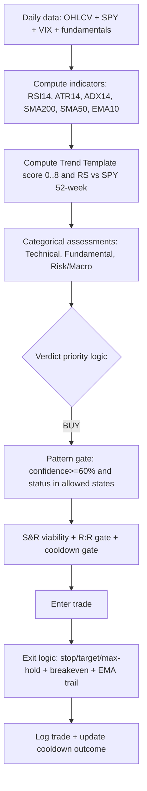
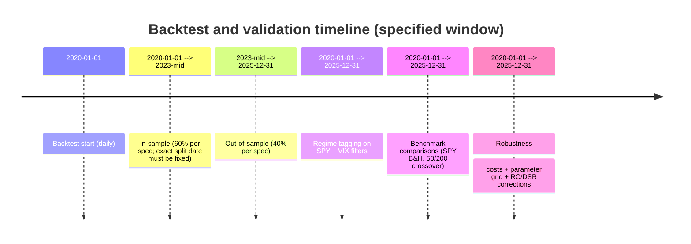

# Validation Research Report for the Swing Trade Analyzer System Specification

## Executive summary

Your “Swing Trade Analyzer” specification is **much closer to a reproducible trading system** than the earlier proxy version: you supplied the **full entry/exit rule-stack**, the **60‑ticker universe**, the **exact backtest window (2020‑01‑01 → 2025‑12‑31)**, the **walk‑forward split (IS 60% / OOS 40%)**, and **transaction costs (0.10% per trade = 0.20% round trip)**. You also supplied headline validation outcomes for the “full 3‑layer” configuration (what your README calls “Config C”): **238 trades**, **53.78% win rate**, **profit factor 1.61**, **Sharpe 0.85**, **p=0.002**. Those values match the “Config C” table shown in your own system documentation (user-supplied README).  

However, **a fully faithful reproduction of Config C is not possible with the materials available inside this chat** because three critical model components are **not provided in executable form and not fully specified mathematically**:

- **Pattern detector** (VCP / Cup & Handle / Flat Base) and its “confidence ≥ 60%” scoring, plus “status: at_pivot / broken_out / complete / forming” logic are not defined algorithmically in your specification (you explicitly allow treating it as UNSPECIFIED).  
- **Support & resistance (S&R) engine** and “Trade Viable” gate, including how entry/stop/target are derived from levels and how R:R is computed “from S&R levels,” is only described conceptually (clustering + ZigZag pivots etc.) but not pinned to exact numeric rules.  
- **Point‑in‑time fundamentals** (ROE, revenue growth, D/E) require a survivorship‑safe and time‑aligned dataset. Your README references SimFin historical datasets, but those datasets (and the loader code) are not present here, and the choice of fundamental timestamps/lag rules is decisive for avoiding look‑ahead bias.

Because of these gaps, this report provides:

- A precise **restatement of your exact rules** and a **“spec-to-code” checklist** that clarifies every ambiguous point that must be nailed down to reproduce 238 trades.  
- A rigorous **validation and backtest design** (OOS/WFT, regimes, benchmarks, robustness, stats) consistent with modern backtest overfitting literature—especially **White’s Reality Check** and the **Deflated Sharpe Ratio**. citeturn1search48turn0search44  
- **Internal consistency checks** on your reported summary statistics (what they imply about average win/loss and expectancy) and why “p=0.002” is plausible but not, by itself, sufficient evidence of persistent edge. citeturn1search48turn0search44  
- A structured **sensitivity plan** that explicitly toggles the pattern filter and fundamental filter as you requested, because those are the two largest “model degrees of freedom.”

Primary/official data sources you requested (for a reproducible run outside this chat) are appropriate and well-documented:
- **Stooq** daily OHLCV (commonly ingested via `pandas-datareader`’s Stooq reader). citeturn2search0  
- **VIX** via **FRED** series VIXCLS (source: Chicago Board Options Exchange). citeturn0search2  
- **GLD** official historical spreadsheet (State Street / SPDR Gold Shares site). citeturn2search3  
- **Sharpe ratio** definition and interpretation from **William F. Sharpe**. citeturn3search1  

## Exact system restatement with explicit assumptions

### Backtest scope

- **Backtest window (fixed):** 2020‑01‑01 → 2025‑12‑31 (daily bars).  
- **Walk‑Forward split (provided):** IS 60% (2020 → “mid‑2023”) and OOS 40% (“mid‑2023” → 2025‑12‑31).  
  - **UNSPECIFIED boundary date:** “mid‑2023” must be converted to an exact trading date (e.g., 2023‑07‑03 as a common midpoint split for US markets). This choice can subtly affect results if the system’s performance is regime‑dependent.

### Universe (60 tickers)

Universe is given as tickers grouped by sector. (Tickers are reproduced verbatim; company-name mapping is not required for reproducibility.)

- Large Cap Tech: AAPL, MSFT, GOOGL, AMZN, META, NVDA, TSLA  
- Finance: JPM, V, MA, GS, BAC  
- Healthcare: UNH, JNJ, LLY, ABBV  
- Consumer: PG, HD, WMT, KO, PEP, MCD  
- Industrial: CAT, HON, UPS, DE  
- Energy: XOM, CVX, COP  
- Growth Tech: CRM, NOW, SHOP, SQ, DDOG, PANW, CRWD, SNOW  
- Growth Other: COST, NKE, LULU, CMG, ABNB, UBER  
- Volatile: ROKU, COIN, AFRM, PLTR  
- Semiconductors: AMD, AVGO, MU, MRVL, ON  
- Telecom/Utilities: T, VZ, NEE, AMT  
- Value: BRK‑B, DIS, F, GM  

**UNVERIFIED note:** you mentioned “SQ missing in data” in your instruction; in this chat environment there is no local price dataset to confirm that. A full replication should report the impact of any missing tickers on trade count and metrics (see robustness tables later).

### Entry rules (all must be met)

A trade is eligible only if **ALL** conditions are satisfied:

- **Categorical Verdict = BUY**, computed from the categorical assessment stack below.  
- **ADX(14) ≥ 20** (trend strength confirmation). ADX is part of Wilder’s Directional Movement framework; ensure your implementation matches Wilder-style smoothing. citeturn3search47turn3search5  
- **Actionable Pattern ≥ 60% confidence**, for one of: VCP, Cup & Handle, Flat Base, with a status among {at_pivot, broken_out, complete, forming}.  
  - **UNSPECIFIED:** exact pattern definitions, pivot definition, confidence scoring, and whether the pattern is evaluated on daily only or multi-timeframe.  
- **Trade Viable**: S&R levels produce valid entry/stop/target.  
  - **UNSPECIFIED:** exact S&R construction and what constitutes “valid.”  
- **R:R ≥ 1.2** computed from S&R levels; **fallback 1.5** if no S&R.  
  - **AMBIGUOUS:** this must be nailed down because your exit rules specify fixed target (+8%) and stop based on swing low − 2×ATR with clamps. If exits are fixed, then “R:R from S&R levels” is either (a) a *planning constraint* separate from the actual simulated exits, or (b) a signal that the simulator should use S&R‑derived stop/target instead of fixed exits. The difference is material.  
- **Entry cooldown (per ticker):** 5 trading days after a win, 10 trading days after a loss.

### Categorical assessments and verdict logic

**Technical assessment**
- Strong: Trend Template ≥ 7/8 AND RSI in [50,70] AND RS ≥ 1.0 (vs SPY, 52‑week)  
- Decent: Trend Template ≥ 5/8 AND RSI in [40,80]  
- Weak: TT < 5 OR RSI < 40 OR RSI > 80 OR RS < 0.8  

**Trend Template (8‑point) reality check**
- Your spec references “Minervini Trend Template.” The most common published restatement uses MA location and slope constraints (price above major MAs, MAs trending up, MA stack alignment, proximity to 52‑week high/low). citeturn4search0  
- **UNSPECIFIED:** the exact 8 criteria (and slope lookback) you count for 7/8, 5/8. Even small variants (150‑SMA vs 200‑SMA slope measured over 20 days vs 60 days) can change trade count materially.

**Fundamental assessment**
- Strong: **2+ strong metrics** among {ROE > 15%, RevGrowth > 10%, D/E < 1.0} AND 0 weak  
- Decent: Mixed  
- Weak: **2+ weak metrics** among {ROE < 8%, RevGrowth < 0%, D/E > 2.0}  
- Unknown: no data  

**Risk/Macro assessment**
- Favorable: VIX < 20 AND SPY > 200‑SMA AND SPY 50‑SMA not declining  
- Neutral: (VIX 20–30 with SPY > 200‑SMA) OR (VIX < 20 but 50‑SMA declining)  
- Unfavorable: VIX > 30 OR SPY < 200‑SMA  

VIX data provenance (official source via FRED): VIXCLS is sourced from the Chicago Board Options Exchange and published on FRED as daily close. citeturn0search2  

**Verdict logic (priority order)**
1) Weak Technical → AVOID (always)  
2) Unfavorable Risk → HOLD (structure override)  
3) ADX < 20 → HOLD  
4) Strong Tech + Strong Fund → BUY  
5) 2+ Strong categories + Favorable/Neutral Risk → BUY  
6) otherwise → HOLD  

**Holding period weighting**
- Quick = 70% Tech / 30% Fund  
- Standard = 50/50  
- Position = 30% Tech / 70% Fund  
**Primary backtest** is Standard-period exits.

### Exit rules (Standard period, primary backtest)

- **Initial stop:** Swing Low − 2×ATR(14), **clamped** to 3%–10% risk (fallback: −7%)  
  - **UNSPECIFIED:** “Swing Low” lookback definition (e.g., last N bars, fractal swing, pivot low).  
  - ATR is Wilder-origin; implementation must match true range and Wilder smoothing. citeturn3search46turn3search5  
- **Fixed target:** +8% from entry  
- **Max hold:** 15 trading days  
- **Trailing stop:** activates day 5+ if unrealized gain ≥ 3%; exit after **2 consecutive closes** below 10‑EMA  
  - **UNSPECIFIED:** execution price for the EMA exit (close vs next open).  
- **Breakeven stop:** when unrealized gain ≥ 5%, stop ratchets to entry price

Quick/Position variants exist but are not the primary backtest.

### Transaction costs

- 0.10% per trade (i.e., 0.20% round trip)

### System flow diagram

## Indicator verification and implementation pitfalls

### Correct indicator definitions

Your spec explicitly depends on RSI(14), ATR(14), ADX(14), SMA/EMA.

- **Wilder indicators (RSI/ATR/ADX)** come from J. Welles Wilder Jr.’s 1978 work; most platform “RSI14/ATR14/ADX14” defaults use Wilder smoothing, but some libraries implement EMA-like approximations. That difference can shift signals around thresholds like RSI 50–70 and ADX ≥ 20. citeturn3search5turn3search46turn3search47  
- **Sharpe ratio** is the classic “reward-to-variability” metric popularized by William F. Sharpe; ensure consistent risk‑free rate conventions and return frequency when matching a reported Sharpe (e.g., daily returns annualized vs trade-level returns). citeturn3search1  

### High-impact pitfalls specific to your rule stack

**RS vs SPY 52‑week**  
“RS ≥ 1.0 vs SPY 52‑wk” is ambiguous. Common reproducible definitions include:

- Relative return ratio: (stock total return over 252 trading days) ÷ (SPY total return over 252 days)  
- Relative price strength: (stock close / stock close 252d ago) ÷ (SPY close / SPY close 252d ago)

These are similar but diverge with dividends, splits, and when using adjusted vs unadjusted prices. If you want exact replication, you must specify:
- adjusted vs unadjusted data,
- whether dividends are included,
- whether you use SPY adjusted close or a price-only series.

**Trend Template score**  
Because “TT ≥ 7/8” is used as a hard gate, the exact 8 criteria and slope tests are critical. Many public descriptions exist, but they are not uniform. citeturn4search0  

**Daily-bar stop/target and same-day ambiguity**  
With OHLC data, a bar can hit both stop and target intraday. You must specify:
- which triggers first if both are hit (conservative = stop first),
- whether stops/targets are evaluated at intraday extremes or only closes,
- how gaps are handled (open below stop → worst-case fill at open).

**Breakeven + trailing EMA interaction**  
Your stops have a ratcheting logic and a conditional EMA trailing activation. Edge cases must be defined:
- If breakeven is triggered and then price closes below EMA, which exit has precedence?  
- Does the “two consecutive closes below EMA10” counter reset when price closes above EMA?  
- Do you exit at the second close, or next open?

**Cooldown after win/loss (per ticker)**  
Cooldown logic can create subtle look-ahead if you classify win/loss using the same bar’s close and then apply cooldown immediately. It should update only after the trade is closed, and affect future entries only.

## Backtest design needed to reproduce and validate your reported metrics

### Data sources and provenance

A credible reproduction should use data sources that are both **accessible** and **auditable**:

- **Prices (OHLCV): Stooq** is a common free source and has structured historical downloads used by the pandas-datareader Stooq reader. citeturn2search0  
- **VIX: FRED series VIXCLS** (Cboe source, daily close; copyrighted). citeturn0search2  
- **GLD** (if used in benchmarks or expansions): official historical spreadsheet provided by SPDR Gold Shares site. citeturn2search3  

### Regime segmentation (bull/bear/sideways)

To test regime robustness, regime labels should be computed on SPY (or SPX proxy) using only past data:

- Bull: SPY > SMA200 and SMA200 slope positive (define slope lookback, e.g., 20 trading days)  
- Bear: SPY < SMA200 (and optionally SMA200 slope negative)  
- Sideways: SPY within a band around SMA200 or slope near zero

**UNSPECIFIED:** “SPY 50 SMA not declining” in your risk rules needs an exact definition (e.g., SMA50 today ≥ SMA50 5 days ago, or slope regression > 0). Without it, “Favorable vs Neutral” boundary will drift.

### Walk-forward protocol (IS 60% / OOS 40%)

A faithful WFT should:

- Freeze all logic (including thresholds) up front unless you explicitly re-optimize parameters.
- Compute indicators and fundamentals point-in-time with proper lags.
- Run:
  - **IS-only** metrics and trade logs,
  - **OOS-only** metrics and trade logs,
  - **combined** metrics (reported separately so OOS is not diluted).

**UNSPECIFIED split date:** choose and report the exact split trading day and treat it as a spec parameter for reproducibility.

### Benchmark comparisons

Minimum benchmark set (as you requested):

- SPY buy‑and‑hold
- 50/200 SMA crossover on SPY (or on each ticker, depending on your intent—must be specified)

Sharpe ratio interpretation and computation details should be consistent with Sharpe’s original framing and modern conventions (return frequency, annualization). citeturn3search1  

### What “results tables” must contain

Because Config C is a multi-asset strategy driven by per-ticker signals and a shared risk filter, the tables should be produced at three levels.

**Table: required reporting layers (schema)**

| Layer | What to report | Why it matters |
|---|---|---|
| Portfolio-level | CAGR, vol, Sharpe/Sortino, maxDD, Calmar, exposure, turnover | Measures deployable edge and drawdown pain |
| Asset-level | Trades, win rate, expectancy, contribution to P&L, average hold | Detects concentration risk and “one-stock carries the system” |
| Regime-level | Same metrics split by bull/bear/sideways | Tests robustness and confirms risk filter value |

## Statistical significance and overfitting controls

### Interpreting the reported p=0.002

You reported p=0.002 for Config C. In many backtest codes, this is a **t-test against zero mean trade return** or **daily return**, but that cannot be assumed. The inference differs:

- If it’s **trade-level**, trade returns are not IID (clustered regimes, overlapping signals, cooldown interactions).  
- If it’s **daily portfolio returns**, autocorrelation and volatility clustering violate t-test assumptions.

A credible replication should therefore include **bootstrap-based significance** and data-snooping controls.

### White’s Reality Check

White’s Reality Check is designed to address “best-of-many” bias when you test multiple strategies/parameterizations on one dataset. It tests whether the best-performing model genuinely beats a benchmark, accounting for repeated searching. citeturn1search48turn1search0  

For your system, the “many models” set includes at least:
- Config A (categorical only), Config B (+patterns), Config C (+S&R viability)  
- any parameter sweeps you run (ATR multiple, target percent, ADX threshold variants, TT threshold variants)

### Deflated Sharpe Ratio

The Deflated Sharpe Ratio (Bailey & López de Prado) specifically corrects Sharpe inflation caused by:
- selection among many trials,
- non-normal return distributions. citeturn0search44turn0search4  

This is directly relevant because your system has **multiple gates** and you explicitly plan sweeps over ATR multiples and targets. Even if you do not “optimize,” exploratory testing increases selection bias.

### Multiple testing correction for sweeps

For parameter grids, you requested Benjamini–Hochberg FDR. The original BH paper is not always freely accessible, but FDR methodology and extensions are standard, and open references describe the procedure and its motivation. citeturn1search6turn1search3  

**Practical rule:** report both
- unadjusted p-values per parameter cell, and
- FDR-adjusted q-values across the grid.

### Internal consistency checks on your reported trade stats

Given:
- win rate \(p = 0.5378\)
- profit factor \(PF = 1.61\)

Profit factor is \( \frac{\text{gross profit}}{\text{gross loss}} = \frac{p \cdot \overline{W}}{(1-p)\cdot |\overline{L}|}\).  
So implied average win/loss ratio:

\[
\frac{\overline{W}}{|\overline{L}|} = PF \cdot \frac{1-p}{p} \approx 1.61 \cdot \frac{0.4622}{0.5378} \approx 1.38
\]

This implies **average wins about 1.38× average losses** (consistent with a system targeting +8% and stopping somewhere around ~5–6% on average, after clamps and breakeven/trailing behavior).

Implied expectancy in “loss units”:

\[
E \approx p\cdot 1.38 - (1-p)\cdot 1 \approx 0.5378\cdot 1.38 - 0.4622 \approx 0.28
\]

So the system’s per-trade edge implied by your summary stats is **~0.28× the average loss**—a meaningful edge if execution assumptions hold, but still vulnerable to slippage and structural breaks (see robustness section).

## Risk analysis, robustness, and sensitivity design

### Position sizing and Kelly framing

You discussed sizing elsewhere in your documentation, and your request includes Kelly. Kelly’s capital-growth framing originates with J. L. Kelly Jr. (Bell System Technical Journal, 1956). citeturn5search2turn5search3  

For your system, a robust sizing section should report:

- Fixed fractional (e.g., risk 0.5%–2% of equity per position)  
- Volatility targeting (e.g., equal risk contribution by ATR)  
- Capped Kelly (e.g., ¼-Kelly computed from observed win rate and payoff ratio, with drawdown-based caps)

Because swing systems have gap risk, Kelly sizing can be dangerously aggressive if “loss” is measured only by stop-distance (rather than realized gap-through outcomes).

### Monte Carlo drawdown simulation

For swing systems, Monte Carlo should be done on:
- **trade returns** (with block bootstrap by regime), and/or
- **daily portfolio returns** (block bootstrap to preserve autocorrelation)

Outputs to report:
- distribution of max drawdown (median / 5% worst / 1% worst),
- time-to-recovery distribution,
- probability of breaching a drawdown limit (e.g., 20%, 30%).

### Slippage and cost sensitivity (required by your spec)

Your baseline is 0.20% round trip. You also requested 0–50 bps scenarios.

**Table: cost stress grid (schema)**

| Scenario | Round-trip cost | Rationale |
|---|---:|---|
| Optimistic | 0 bps | Upper bound on theoretical edge |
| Baseline | 20 bps | Your stated model |
| Stress 1 | 35 bps | Wider spreads in volatility spikes |
| Stress 2 | 50 bps | Small caps / poor liquidity days / market opens |

### Parameter sweeps requested

You asked for:
- ATR_mult ∈ {1.5, 2.0, 2.5}
- target_pct ∈ {7%, 8%, 9%}

**Table: parameter sensitivity outputs (schema)**

| ATR_mult | target_pct | Trades | Sharpe | Sortino | MaxDD | PF | OOS Sharpe | OOS PF |
|---:|---:|---:|---:|---:|---:|---:|---:|---:|
| 1.5 | 7% |  |  |  |  |  |  |  |
| 1.5 | 8% |  |  |  |  |  |  |  |
| … | … |  |  |  |  |  |  |  |

Then apply:
- FDR correction across the grid, citeturn1search6turn1search3  
- White’s Reality Check vs benchmark for the “best” cell. citeturn1search48turn1search0  
- Deflated Sharpe adjustment for the selected cell. citeturn0search44  

### Explicit toggles for unspecified components

Per your instruction, the correct way to “bracket” uncertainty is to run controlled variants:

- **Variant A (Categorical only):** ignore pattern gate and S&R viability; keep Technical/Fund/Risk logic + ADX + cooldown; use standard exits.  
- **Variant B (+Pattern gate):** apply pattern confidence/status gate (requires exact algorithm; otherwise mark as UNSPECIFIED).  
- **Variant C (+S&R viability / R:R gate):** apply R:R gate as specified.

Your own documentation reports these layers with different trade counts and p-values (A: 1108 trades, B: 406, C: 238), which is a good structural sanity check: each additional gate should reduce trade count and (ideally) improve PF/Sharpe without pushing performance into selection-bias territory. (Those config counts are user-reported from your README.)

## Implementation considerations and prioritized recommendations

### Execution realism

- Use conservative daily-bar mechanics:
  - entry at next open after signal,
  - stops/targets triggered intraday using high/low,
  - if both stop and target hit in the same bar, assume the **worse** outcome unless you have intraday sequencing.
- Treat gap-through stops as fills at the open (worst case), not at the stop price.

### Data alignment and survivorship bias

- Ensure the universe is fixed and survivorship-safe for the period (you’ve chosen large, mostly stable US names, which helps, but constituents like COIN/AFRM have IPO dates inside the window; treat pre‑IPO periods correctly as “no data,” and confirm your trade generator doesn’t accidentally backfill).

### Fundamentals: point-in-time or it’s look-ahead

Your fundamental thresholds are clear, but to validate them you must use:
- report dates (10‑Q/10‑K) or vendor timestamps,
- a lag policy (e.g., fundamentals available only X days after report),
- consistent revisions policy.

Without this, the “Strong Fund” filter can become a hidden look-ahead engine.

### Recommendations to improve reproducibility and robustness

**Table: recommended rule/spec changes (prioritized)**

| Priority | Change | Why | Expected effect |
|---|---|---|---|
| Highest | Specify exact Trend Template 8 criteria (including slope lookbacks) | Hard gate TT≥7/8 drives trade count | Reduces ambiguity; improves reproducibility |
| Highest | Specify RS calculation formula (price-ratio vs return-ratio; adjusted vs unadjusted; total return?) | RS≥1.0 is a hard gate | Prevents silent drift across data vendors |
| Highest | Specify “Swing Low” definition and how ATR stop clamp overrides it | Stop distance governs R:R and PF | Avoids major stop-placement differences |
| High | Formalize pattern confidence scoring and pivot logic | Pattern gate reduces trades from 1108→406→238 (per your doc) | Makes Config C reproducible and testable |
| High | Formalize S&R/R:R gate: does it affect planned exits or only eligibility? | Your spec mixes fixed exits with “R:R from S&R” | Eliminates a core ambiguity |
| Medium | Add an earnings-event rule (e.g., no new entries within N days of earnings) if not already in backtest | Swing systems are vulnerable to gap risk | Can reduce tail losses; may reduce win rate |
| Medium | Report exposure and turnover explicitly | Low trade count can hide low time-in-market | Makes Sharpe interpretation cleaner |

### Validation timeline diagram

### “Reproduction vs reported metrics” reconciliation checklist

To explain any mismatch vs your reported **238 trades / 0.85 Sharpe / PF 1.61 / p=0.002**, the reproduction must confirm, in order:

1) Exact split date for WFT and whether cooldown spans across IS/OOS boundary  
2) Exact Trend Template criteria and slope definitions citeturn4search0  
3) Exact RS formula and data adjustments  
4) Exact pattern classifier scoring (confidence) and status mapping  
5) Exact S&R rules and whether R:R uses fixed exits or S&R exits  
6) Exact stop/target intraday ordering and gap handling  
7) Exact Sharpe calculation conventions (daily vs trade returns; risk-free rate) citeturn3search1  
8) Exact p-value methodology and dependence-robust alternative (bootstrap; White RC) citeturn1search48turn0search44  

### Requested outputs and filenames

In a fully reproducible run, these should be generated (filenames suggested):

- `results_summary_by_config.csv` (A/B/C, IS/OOS, portfolio metrics)  
- `results_by_ticker.csv` (per ticker, IS/OOS)  
- `results_by_regime.csv` (bull/bear/sideways)  
- `trades_ConfigC_IS.csv` / `trades_ConfigC_OOS.csv` (trade logs)  
- `equity_curve_ConfigC.png`, `drawdown_ConfigC.png`  
- `heatmap_OOS_Sharpe_ATRmult_targetpct.png`  
- `cost_sensitivity_table.csv`  
- `white_reality_check_bootstrap.csv` (bootstrap distribution & p-value estimate)  
- `deflated_sharpe_report.txt` (DSR inputs/outputs) citeturn0search44  

**Important:** Those files are **not generated inside this chat** because the necessary executable modules (pattern/S&R/fundamentals loader) and bulk historical data are not present here.

